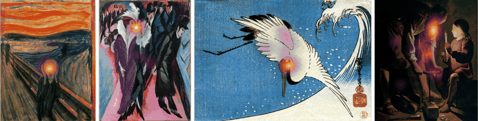
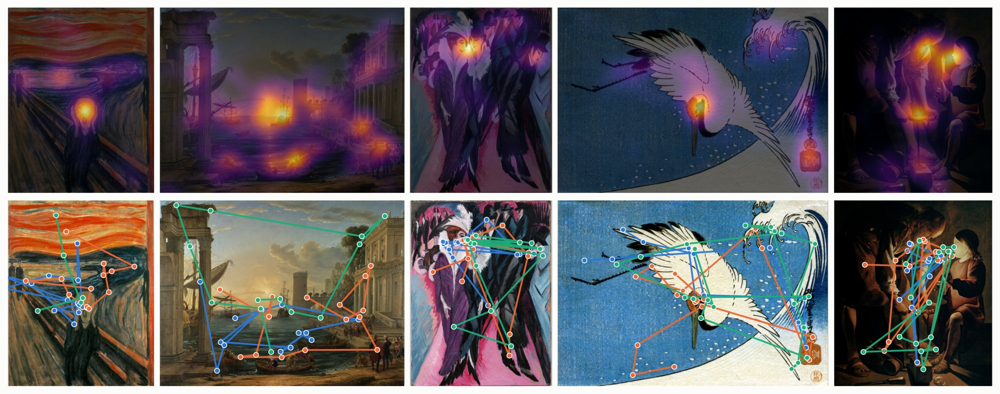

<div align="center">

# AVAtt — Art Visual Attention

**A free-viewing eye-tracking dataset and benchmark for visual attention on paintings**

[](https://huggingface.co/datasets/Amine-CV/AVAtt)
[](https://doi.org/10.1145/3649902.3655656)
[](LICENSE)
[](https://creativecommons.org/publicdomain/zero/1.0/)
[](pyproject.toml)



*Attention accumulating over the first five seconds of free viewing, from 15+ observers per painting.*

</div>

---

**AVAtt** records where people look when they freely view paintings. It covers **283 paintings** from **16 art movements** — from Early Renaissance frescoes to Ukiyo-e prints, Chinese ink, Cubism and
abstract art — with **4,505 individual scanpaths** and **121,426 fixations** from **152 observers**.

| | |
|---|---|
| 🖼️ **Paintings** | 283, 16 movements, 81 identified artists, with title / year / movement / genre metadata |
| 👁️ **Gaze** | 4,505 scanpaths, 121,426 fixations, 10–32 observers per painting (median 15) |
| 🗺️ **Maps** | binary fixation maps and saliency maps at 1° of visual angle (35.87 px, measured geometry) |
| 🎞️ **Temporal** | one 60 fps video per painting showing how attention accumulates over 5 s |
| 📏 **Per fixation** | position, onset, duration and eye–screen distance |
| 🧪 **Benchmarks** | saliency (7 models + human ceiling) and 44 scanpath-similarity measures |

## Contents
- [Quick start](#quick-start)
- [Data format](#data-format)
- [Benchmarks](#benchmarks)
- [What draws the eye in paintings](#what-draws-the-eye-in-paintings)
- [Reproducing the paper](#reproducing-the-paper)
- [Repository layout](#repository-layout)
- [Citation](#citation)
- [License](#license)

## Quick start

```bash
pip install git+https://github.com/kmamine/AVAtt---Art-Visual-Attention.git
```

```python
import avatt

ds = avatt.load()                 # downloads the dataset from the Hugging Face Hub on first use (~250 MB)
print(ds)                         # AVAtt(root=..., paintings=283, scanpaths=4505, fixations=121426)

ds.metadata.loc["avatt_0003", ["title", "artist", "year", "movement"]]
# The Scream · Edvard Munch · 1893 · Expressionism

img = ds.image("avatt_0003", crop=True)          # the painting without its grey frame
scanpaths = ds.scanpaths("avatt_0003")           # one DataFrame per observer: x, y, onset_ms, duration_ms, distance_mm
gt = ds.saliency_map("avatt_0003")               # 1600×900 saliency map, σ = 1°
fixmap = ds.fixation_map("avatt_0003")           # 1600×900 binary map

# evaluate your own model
from avatt import metrics
pred = my_model(ds.image("avatt_0003"))                       # any 900×1600 saliency map
scores = metrics.all_metrics(pred, fixmap, gt)                 # AUC-Judd, NSS, CC, SIM, KL (+ sAUC)
```

Prefer 🤗 `datasets`? Everything except the videos is also available as Parquet:

```python
from datasets import load_dataset
ds = load_dataset("Amine-CV/AVAtt", split="train")
ds[0]["image"], ds[0]["saliency_map"], ds[0]["scanpaths"]
```

Build your own maps from the scanpaths, e.g. attention up to 1 s:

```python
from avatt import maps
early = maps.temporal_saliency_map(ds.scanpaths("avatt_0003"), t_ms=1000)
```

## Data format

```
AVAtt/
├── metadata.csv                     one row per painting
├── images/<id>.jpg                  1600×900 stimulus (painting centred on grey, RGB 170)
├── scanpaths/<id>.jsonl             one JSON line per observer
├── fixation_maps/<id>.png           binary fixation map
├── saliency_maps/<id>.png           fixation map ⊛ Gaussian (σ = 1° = 35.87 px)
└── temporal_saliency_maps/<id>.mp4  60 fps, 5 s, attention accumulated up to t
```

A scanpath line:

```json
{"observer": 1, "fixations": [{"x": 590, "y": 487, "onset_ms": 0, "duration_ms": 396, "distance_mm": 546.3}, ...]}
```

Coordinates are canvas pixels; `onset_ms` is relative to the first fixation on the painting. Key `metadata.csv` columns:

| column | description |
|---|---|
| `image_id` | `avatt_0001` … `avatt_0283` |
| `title`, `artist`, `year` | identification of the work |
| `movement`, `movement_group` | art movement and one of 16 movement groups |
| `genre`, `medium` | e.g. landscape / portrait, oil / woodblock print |
| `attribution_confidence` | `high` (identified work) · `medium` (artist attributed) · `low` (movement only) |
| `copyright_status` | `public domain` · `in copyright` · `unknown` |
| `exposure_s` | presentation time (5.5 s or 15 s) |
| `n_observers`, `n_fixations` | counts |
| `painting_x0, y0, x1, y1` | the painting inside the 1600×900 canvas |

**Recording.** Tobii X2-30 (30 Hz), 9-point calibration, 1920×1080 display (531 mm wide, measured), mean viewing
distance 56.8 ± 3.9 cm, free-viewing instruction *"freely view and enjoy the paintings"*. Scanpaths are kept if they
span ≥ 4.5 s, paintings if they have ≥ 10 valid scanpaths.

## Benchmarks

### Saliency prediction
Evaluated on the painting only (grey frame removed), split-half against the held-out half of the observers.

| Model | AUC-J ↑ | sAUC ↑ | NSS ↑ | CC ↑ | SIM ↑ | KL ↓ |
|---|---|---|---|---|---|---|
| *Human (other half)* | *0.807* | *0.713* | *1.58* | *0.807* | *0.722* | *0.551* |
| **UNISAL** | **0.776** | **0.654** | **1.27** | **0.695** | **0.659** | 0.600 |
| DeepGaze IIE | 0.771 | 0.620 | 1.22 | **0.695** | 0.638 | 0.589 |
| TranSalNet-Res | 0.771 | 0.649 | 1.21 | 0.680 | 0.658 | 0.533 |
| GBVS ([PyTorch](https://github.com/kmamine/GBVS_Pytorch)) | 0.744 | 0.594 | 0.94 | 0.559 | 0.618 | **0.524** |
| Itti–Koch | 0.724 | 0.621 | 0.84 | 0.489 | 0.592 | 0.561 |
| Spectral residual | 0.670 | 0.629 | 0.63 | 0.355 | 0.542 | 0.717 |
| Centre bias | 0.718 | 0.503 | 0.77 | 0.490 | 0.590 | 0.572 |

The gap to the human ceiling leaves plenty of room for art-aware saliency models.

### Scanpath similarity
Which measures capture shared viewing? Two observers of the same painting vs an observer and a scanpath from another
painting mapped onto it (AUC; 12,735 pairs, first 5 s).

| Measure | AUC ↑ | paintings where same-image pairs win |
|---|---|---|
| **[FDISS](https://pypi.org/project/fdiss/)** | **0.796** | **99.6 %** |
| DINOv3 patch-BERTScore (image-encoder) | 0.769 | 98.2 % |
| ResNet-50 / VICReg patch-BERTScore | 0.753 | 98.9 % |
| Mannan | 0.691 | 95.4 % |
| MultiMatch (position) | 0.625 | 90.5 % |

44 measures in total — FDISS, the [eyefeatures](https://pypi.org/project/eyefeatures/) distances, and
language-free image-encoder variants of [scanpath-nlp-metrics](https://pypi.org/project/scanpath-nlp-metrics/) built
on 10 CNN, ViT and self-supervised encoders (VGG, ResNet, ConvNeXt, ViT, CLIP, MAE, DINOv2, DINOv3, I-JEPA, VICReg).

## What draws the eye in paintings



- **Faces** receive about **5×** more fixations than expected and are reached within **0.4 s**.
- **Local structure** — edges, spatial detail, contrast — attracts the eye more than colour.
- **Composition matters**: where a painting fits a composition template better (thirds, golden spiral, diagonals…),
  viewers look more at its points and lines.
- **Style shapes agreement**: Chinese ink and Realism produce the most consistent viewing; format and composition
  set *where* the eye travels, content sets *how long* it stays.

All comparisons use a bias-free baseline: other paintings' scanpaths mapped onto the same canvas.

## Reproducing the paper

```bash
git clone https://github.com/kmamine/AVAtt---Art-Visual-Attention.git && cd AVAtt---Art-Visual-Attention
conda create -n avatt python=3.12 -y && conda activate avatt
pip install -e ".[analysis]"
python -c "import avatt; avatt.download('data/AVAtt')"      # dataset
python scripts/setup_third_party.py                          # pinned third-party models and weights
python scripts/run_all.py                                    # all analyses → results/
```

`run_all.py` runs the steps in order (`--from STEP` / `--only STEP` to resume or select). A 4 GB CUDA GPU is enough;
the full pipeline takes a few hours on a laptop.

| step | script | output |
|---|---|---|
| descriptive statistics | `analysis/analysis.py` | eye-movement, image and agreement statistics |
| content detection | `analysis/composition_detect.py` | salient objects (BiRefNet), YOLO26 / YOLOE-26 objects, faces, depth, composition classes |
| composition fitting | `analysis/composition_fit.py` | 8 template families incl. 8 golden-spiral variants, selection-corrected |
| temporal dynamics | `analysis/temporal.py` | duration / amplitude / agreement over time |
| saliency models | `analysis/saliency_models.py` | GBVS, Itti–Koch, spectral residual, UNISAL, DeepGaze IIE, TranSalNet |
| saliency benchmark | `analysis/benchmark.py` | metrics table, observers needed |
| features, faces, composition | `analysis/features_baseline.py`, `faces_objects.py`, `composition_fixations.py` | attention vs content |
| scanpath similarity | `analysis/scanpath_similarity.py`, `scanpath_embeddings.py`, `similarity_stats.py` | 44 measures |
| painting factors & style | `analysis/painting_factors.py`, `style_analysis.py` | what explains viewing |

Set `AVATT_DATA`, `AVATT_RESULTS` or `AVATT_THIRD_PARTY` to use other locations. The scanpaths were built from the Tobii
exports with `scripts/build_from_tobii.py`, and the Hugging Face release with `scripts/make_release.py`.

## Repository layout

```
avatt/          Python package: loading, maps, metrics, geometry
analysis/       full analysis pipeline of the paper
scripts/        setup, pipeline runner, dataset build and release
paper/          LaTeX source of the preprint
tests/          pytest suite (synthetic data; set AVATT_DATA to also test a local copy)
```

## Citation

```bibtex
@inproceedings{kerkouri2024avatt,
  title     = {{AVAtt}: Art Visual Attention dataset for diverse painting styles},
  author    = {Kerkouri, Mohamed Amine and Tliba, Marouane and Chetouani, Aladine and Bruno, Alessandro},
  booktitle = {Proceedings of the 2024 Symposium on Eye Tracking Research and Applications (ETRA '24)},
  year      = {2024},
  publisher = {ACM},
  doi       = {10.1145/3649902.3655656}
}
```

## License

- **Code**: [MIT](LICENSE).
- **Gaze data, maps, videos and annotations**: [CC0 1.0](https://creativecommons.org/publicdomain/zero/1.0/).
- **Painting images** are not ours to license. Most are in the public domain (`copyright_status` in `metadata.csv`);
  works still under copyright are included solely for non-commercial research, and will be removed on request by a
  rights holder.

## Acknowledgements

Funded by the TIC-ART project of the Centre-Val de Loire Region, France. Data were collected at the PRISME
Laboratory, University of Orléans. We thank all participants, and the authors of UNISAL, DeepGaze, TranSalNet,
CACNet, BiRefNet, Ultralytics YOLO and the encoders used in the benchmarks.
